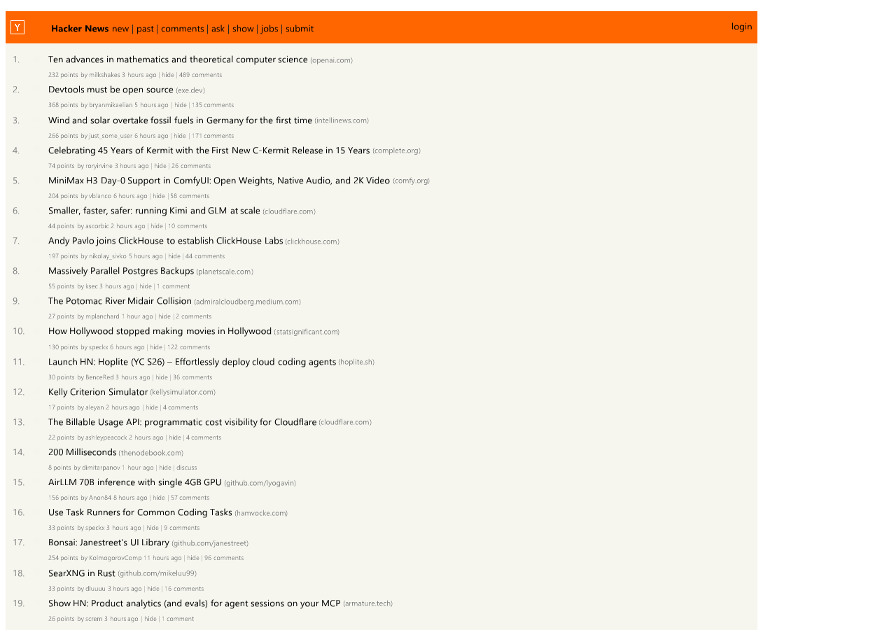

# Um navegador escrito do zero, em Odin

Sem WebView, sem Blink, sem WebKit. O HTML é parseado aqui, a cascata do CSS é
resolvida aqui, o layout é calculado aqui e o JavaScript roda num interpretador
escrito aqui. O que vem de fora é janela, entrada, HTTP e rasterização de
triângulo — [ImGui](https://github.com/ocornut/imgui), SDL2 e libcurl.



*`news.ycombinator.com`, renderizado por `browser.exe --render` a 1280×900.*

## O que é, e o que não é

**É** um motor de verdade: 64 mil linhas de mecanismo mais 37 mil de teste, que
carrega sites reais da internet, roda o JavaScript deles e pinta o resultado.

**Não é** um navegador para usar no dia a dia. Não tem sandbox nem isolamento por
processo, não decodifica H.264, e a distância visual até o Chrome em sites reais
ainda se mede em porcentagem de pixels, não em detalhes. Só builda no Windows.

O que ele **tem**, medido e não prometido, está na tabela abaixo.

## Estado

Todos os números foram medidos em **2026-08-03**, na árvore que está aqui.

| Suíte | Resultado | O que cobre |
|---|---|---|
| Testes de unidade (`test.ps1`) | **2904 / 2904** ✅ | 7 pacotes: 1868 js · 758 ui · 163 css · 81 html · 20 brotli · 10 woff2 · 4 net |
| Reftests do WPT | **353 PASS / 128 FAIL / 0 ERRO** (de 481) | conformidade de CSS e layout contra as referências da spec |
| html5lib, tree-construction | **1689 / 1709** (12 diff, **0 crash**) | conformidade de `parse_document`/`parse_fragment`, o tree builder principal |
| html5lib, tokenizer | **7028 / 7036** | conformidade do emissor `--tokenize` nos estados suportados |
| Test262 | **170 / 299** | conformidade da linguagem JavaScript (subconjunto curado; um caso oscila entre rodadas) |
| Golden de layout | 17 fixtures | regressão de geometria, com nome e número |
| Portão de pintura | 73 asserções | caixa no lugar certo mas **não pintada** — o ponto cego do golden |

Do índice de propriedades do CSS no MDN (526 propriedades), **354 são
reconhecidas** — e 78 dessas são reconhecidas mas inertes *(esta linha é de
2026-07-30, não da medição de hoje)*. A honestidade sobre a
degradação é uma regra do projeto: cada gap conhecido tem um teste que diz
exatamente **qual** é.

### O que funciona

Cascata completa com camadas, `!important`, especificidade de Selectors 4 e
disputa entre shorthand e longhand · fluxo normal, inline, floats, `position` ·
**flexbox** e **grid** (incluindo `minmax()`, `fr`, `auto-fill`) · `calc()`,
`min()`/`max()`/`clamp()`, variáveis, unidades de viewport (`dvh`/`svh`/`lvh`) ·
`@media`, `@supports`, `@font-face` com **WOFF2 decodificado do zero** (Brotli
incluso) e reconstrução do atlas de fontes em tempo de execução · bordas com
raio, sombras, gradientes, transições · SVG com gradientes · WebP, canvas 2D ·
JavaScript com `Promise` e microtasks, geradores, `Proxy`/`Reflect`, `BigInt`,
regex, módulos ES, `MutationObserver`, `IntersectionObserver`, `ResizeObserver`,
`getComputedStyle` e `getBoundingClientRect` de verdade · DevTools com console,
REPL e inspetor de elementos.

### O que falta

Nenhum decodificador de vídeo (`<video>` carrega o pôster e `play()` **rejeita de
propósito** — resolver esconderia o pôster e travaria a página esperando `ended`)
· o interpretador de JS é *tree-walking*, sem JIT, e SPAs pesados demoram · sem
Web Workers, WebGL, WebAssembly ou Service Workers · formulários são parciais ·
aba de Network nos DevTools ainda não existe · só Windows x64.

## Compilar e rodar

O passo a passo completo — incluindo as dependências que **não** estão
versionadas — está em **[docs/BUILD.md](docs/BUILD.md)**. Resumido:

```powershell
$flags="C:\Odin\dist\vendor\sdl2\SDL2.lib /STACK:1073741824"
& C:\Odin\dist\odin.exe build . -out:browser.exe -o:speed "-extra-linker-flags:$flags"
```

⚠️ As duas flags são obrigatórias, e por motivo medido: sem `/STACK` de 1 GB o
tree-walker estoura a pilha e o processo **morre** em sites React; sem `-o:speed`
o interpretador fica 50-100× mais lento, o SPA não termina de renderizar e a
página fica branca — o que parece um bug do motor e é só o build errado.

```powershell
.\browser.exe                    # abre a janela
```

Dentro do app: **F12** abre os DevTools, **F9** grava o frame atual em
`capture.png` (a janela do SDL não é capturável de fora — o conteúdo vive no
swapchain).

### Modos de linha de comando

É por aqui que todas as suítes dirigem o motor:

| | |
|---|---|
| `--render <url> <png> [w h [mx my [frames]]]` | renderiza para PNG, sem janela |
| `--dumplayout <in.html> <out.txt> [w h]` | serializa a árvore de layout |
| `--diagnose <url> [out.json]` | relatório de "por que esta página pode estar quebrada" |
| `--imgdiff <a.png> <b.png>` | diferença visual entre dois renders |
| `--js262 <a.js> [b.js …]` | executa JS numa VM única, sem janela |
| `--parsetree <arquivo>` · `--parsefragment <arquivo> <contexto>` · `--tokenize <arquivo>` | serializações para o html5lib; `--parsetree-legacy` mede o parser simplificado legado |
| `--fetch <url>` | só o pipeline de rede |

## Testar

```powershell
.\test.ps1              # gate oficial: 7 pacotes
.\wpt-reftest.ps1       # reftests do WPT
.\layout-golden.ps1     # goldens de layout
.\paint-check.ps1       # portão de pintura
```

Cada portão é cego para o que os outros enxergam, e todos aceitam
`-Browser <exe>` para A/B entre dois binários. O protocolo de medição — e as
armadilhas que já produziram conclusões falsas — estão em
**[docs/TESTING.md](docs/TESTING.md)**.

## Como o código é organizado

Na raiz ficam a entrada `main.odin`, os comandos de build e teste e os arquivos
de referência. O executável atual `browser.exe` e sua `SDL2.dll` também ficam
aqui, junto de `bookmarks.txt` e `imgui.ini` (dados locais do usuário).

Artefatos locais ficam em `_local/`, ignorado pelo Git: `builds/` guarda
executáveis antigos e de comparação, `reports/` guarda logs e relatórios,
`screenshots/` guarda capturas e `scratch/` guarda experimentos avulsos.
As ferramentas de diagnóstico gravam em `_local/gap-mine/`,
`_local/oracle-shots/` e `_local/ab-paint/`. A captura F9 continua gerando
`capture.png` na pasta de trabalho; as suítes mantêm suas saídas em `tests/*/_out/`.
Para comparar com um build arquivado, use `-Browser .\_local\builds\<nome>.exe`.

`src/net` → `src/html` → `src/dom` → `src/css` → `src/ui` (cascata, layout,
pintura, chrome) e `src/js` (o motor JavaScript, que **não pode** importar
`src/ui`). O mapa dos pacotes e as duas armadilhas que vale conhecer antes de
mexer estão em **[docs/ARCHITECTURE.md](docs/ARCHITECTURE.md)**.

## Licença

[MIT](LICENSE). As suítes de conformância versionadas aqui dentro são de
terceiros e estão creditadas em [THIRD-PARTY.md](THIRD-PARTY.md).
